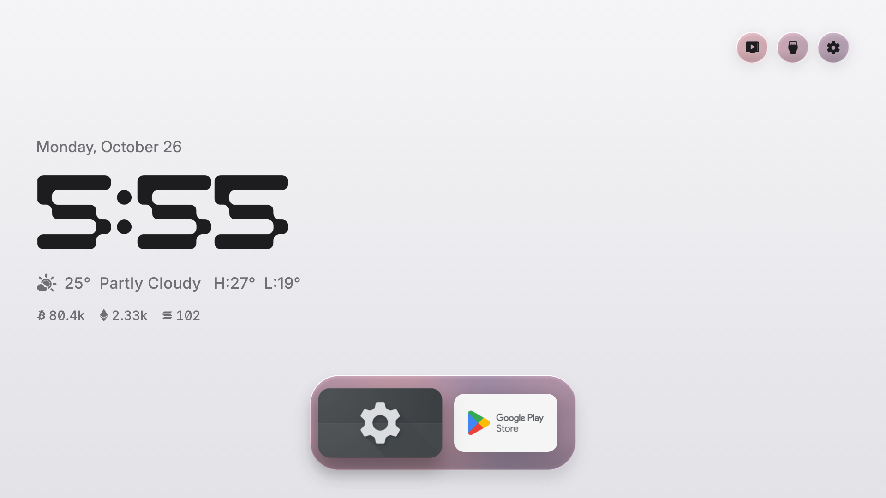

# Free My TV: Android Studio project

An Android Studio (Gradle) repackaging of https://github.com/simbasjungles/free-my-tv (MIT license, see LICENSE with custom UI elements like own clockface and lockscreen 

## Preview



The clock uses the custom typeface `CSaurav.ttf`, located at `/assests/fonts/CSaurav.ttf`.

## Build

1. Install Android Studio (any recent version; it brings JDK 17+). Let it install SDK Platform 34.
2. File > Open > choose this folder. Wait for the Gradle sync (first sync downloads Gradle 8.9 and the Android plugin).
3. (Optional and i like it without TMDB)Open `app/src/main/java/io/slimtvos/Config.java` and set your city, region and TMDB key.
4. Build > Build Bundle(s) / APK(s) > Build APK(s). The file is `app/build/outputs/apk/debug/app-debug.apk`.

## Install on the TV (Google TV / Android TV, Android 9+)

```sh
adb connect <TV_IP>:5555
adb install -r app-debug.apk
adb shell "appops set io.freemytv AUTO_START allow || appops set io.freemytv APP_AUTO_START allow"

Do not send apk directly and install, it will throw a play protect warning, instead try via adb.
